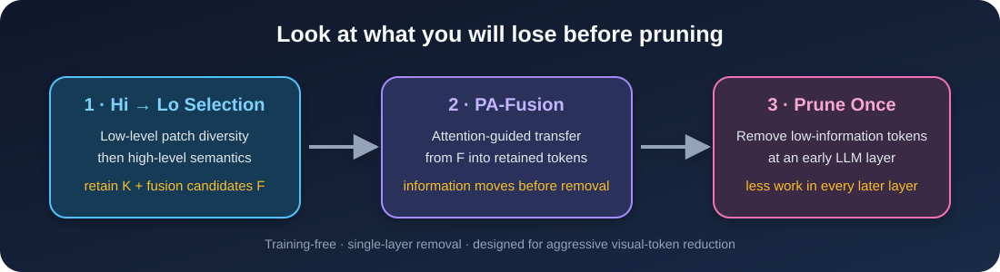

<div align="center">

# Hi-Lo Prune

### Look at What You'll Lose before Pruning with Hierarchical Token Selection

[](https://openaccess.thecvf.com/content/CVPR2026/html/Sun_Hi-Lo_Prune_Look_at_What_Youll_Lose_before_Pruning_with_CVPR_2026_paper.html)
[](https://openaccess.thecvf.com/content/CVPR2026/papers/Sun_Hi-Lo_Prune_Look_at_What_Youll_Lose_before_Pruning_with_CVPR_2026_paper.pdf)
[](https://www.python.org/)

**Zixun Sun · Yubo Dong · Hehe Fan · Yi Yang**

</div>



Hi-Lo Prune is a training-free visual-token pruning method for multimodal large
language models. Instead of immediately dropping apparently redundant tokens,
it first identifies what would be lost, transfers useful information from those
tokens into the retained set, and then prunes once at an early LLM layer.

The method was evaluated in the paper on Qwen2-VL, Qwen2.5-VL, Qwen3-VL and
LLaVA. It remains effective under aggressive visual-token reduction without
fine-tuning.

## Method

Hi-Lo Prune has three stages:

1. **Hierarchical token selection.** Low-level patch features produce a diverse
   candidate pool; high-level visual-token features select the final retained
   set.
2. **Prune-Aware Fusion (PA-Fusion).** Before pruning, sparse attention paths
   transfer information from valuable pruning candidates to retained tokens.
3. **Single-layer removal.** Low-information tokens are removed at a designated
   early Transformer layer, reducing computation in all later layers.

## Code-release status

This initial public release contains the cleaned **Qwen3-VL image-inference
path** recovered from the authors' experiment tree.

| Model evaluated in the paper | Public integration |
| --- | --- |
| Qwen3-VL-8B | ✅ Initial image-inference implementation |
| Qwen2-VL-2B | 🚧 Model adapter still to be packaged |
| Qwen2.5-VL-7B | 🚧 Model adapter still to be packaged |
| LLaVA-1.5-7B | 🚧 Model adapter still to be packaged |
| Video-QA evaluation | 🚧 Evaluation pipeline still to be packaged |

The repository is organized by model so additional adapters can be added
without mixing architecture-specific changes. Please open an issue if you need
one of the pending paths first.

## Installation

The original Qwen3 experiments used Python 3.10, PyTorch 2.6.0,
qwen-vl-utils 0.0.14 and Transformers commit
`e2e8dbed13c6a8455fd85c15c9fa91c99d609010`. The commit is pinned in
`pyproject.toml`.

```bash
git clone https://github.com/sealost/Hi-Lo_Prune.git
cd Hi-Lo_Prune
python -m venv .venv
source .venv/bin/activate
pip install -e .
```

FlashAttention was used for the reported efficiency experiments:

```bash
pip install flash-attn==2.5.9.post1 --no-build-isolation
```

## Quick start

```bash
python examples/qwen3_vl_image.py \
  --image /path/to/image.jpg \
  --prompt "Describe the image in detail." \
  --keep-ratio 0.10 \
  --candidate-ratio 0.30 \
  --prune-layer 2
```

The example downloads `Qwen/Qwen3-VL-8B-Instruct` by default. Pass
`--model` to use a local checkpoint or another compatible Qwen3-VL checkpoint.

### Main controls

Set these attributes on `config.text_config` before
`from_pretrained(..., config=config)`:

| Option | Default | Meaning |
| --- | ---: | --- |
| `hilo_keep_ratio` | `0.10` | Fraction of visual tokens retained |
| `hilo_candidate_ratio` | `0.30` | Coarse candidate-pool fraction |
| `hilo_prune_layer` | `2` | LLM layer that removes tokens |
| `hilo_fusion_strength` | `0.30` | PA-Fusion strength λ |
| `hilo_top_k_ratio` | `0.10` | Sparse fusion top-k ratio |
| `hilo_attention_threshold` | `0.05` | Qwen3 attention threshold τ |
| `hilo_fusion_layers` | `[0, 1]` | Layers that apply PA-Fusion |

## Repository layout

```text
hilo_prune/
├── selection.py                 # architecture-independent Hi→Lo selection
├── patches.py                   # patch features aligned to Qwen visual tokens
└── models/
    └── qwen3_vl/
        └── modeling_hilo_qwen3_vl.py
examples/
└── qwen3_vl_image.py
tests/
├── test_selection.py
└── test_patches.py
```

## Current limitations

- The packaged Qwen3-VL path currently supports one image and batch size 1.
- Video input, multiple images and the remaining paper backbones still need
  their model-specific adapters.
- Full benchmark reproduction requires the public benchmark datasets and their
  official evaluation tools; large result dumps and machine-specific paths are
  intentionally excluded.
- Repository-level licensing should be confirmed by the maintainers. The
  Qwen3-VL model file retains its upstream Apache-2.0 notice.

## Tests

The lightweight tests exercise hierarchical selection and image-to-token patch
alignment without downloading model weights:

```bash
python -m unittest discover -s tests -v
```

## Citation

```bibtex
@InProceedings{Sun_2026_CVPR,
  author    = {Sun, Zixun and Dong, Yubo and Fan, Hehe and Yang, Yi},
  title     = {Hi-Lo Prune: Look at What You'll Lose before Pruning with Hierarchical Token Selection},
  booktitle = {Proceedings of the IEEE/CVF Conference on Computer Vision and Pattern Recognition (CVPR)},
  month     = {June},
  year      = {2026},
  pages     = {31941--31951}
}
```

## Acknowledgements

The Qwen3-VL integration is derived from the Hugging Face Transformers
implementation and keeps its original copyright and Apache-2.0 notice. We
thank the Qwen-VL, Transformers and evaluation-tool authors whose work made
these experiments possible.
